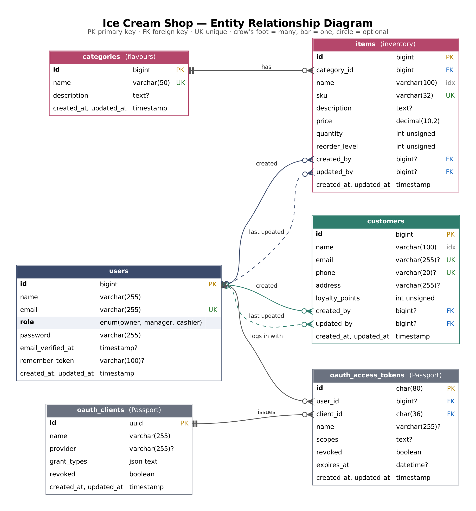

# Ice Cream Shop API

A Laravel 13 + MySQL backend for an ice cream shop. It manages **inventory items** (grouped by flavour) and **customer records**, with **Laravel Passport** authentication and **role-based access control** for three roles: Owner, Manager and Cashier.

- REST API for authentication, inventory and customers, always answering in JSON
- Bearer-token login with Passport personal access tokens, per-device logout and login rate limiting
- Role permissions enforced on the backend through policies, before any validation runs
- Item search by name, plus flavour / low-stock filters, sorting and pagination; customer search by name, email or phone
- Audit trail: every item and customer records which staff member created it and last changed it
- 183 PHPUnit tests (unit + feature), passing on both SQLite and MySQL 8; GitHub Actions CI

## Contents

1. [Tech stack](#tech-stack)
2. [Roles and permissions](#roles-and-permissions)
3. [Database design (ER diagram)](#database-design)
4. [Setup](#setup)
5. [Seed data and initial users](#seed-data-and-initial-users)
6. [Running the backend](#running-the-backend)
7. [API reference](#api-reference)
8. [Testing](#testing)
9. [Project structure](#project-structure)
10. [Design notes](#design-notes)

## Tech stack

| | |
|---|---|
| Language / framework | PHP 8.3+, Laravel 13 |
| Database | MySQL 8 (migrations + seeders) |
| Authentication | Laravel Passport 13 (personal access tokens, `auth:api` guard) |
| Authorization | Laravel policies backed by a role → permission matrix |
| Tests | PHPUnit 12 (SQLite in memory by default, MySQL in CI) |
| Code style | Laravel Pint |

## Roles and permissions

These are exactly the rules from the assessment, enforced by `ItemPolicy` and `CustomerPolicy`. The single source of truth is `app/Enums/Role.php`.

| Action | Owner | Manager | Cashier |
|---|:-:|:-:|:-:|
| View inventory items | ✅ | ✅ | ✅ |
| Add inventory items | ✅ | ✅ | ❌ |
| Edit inventory items | ✅ | ✅ | ✅ |
| Delete inventory items | ✅ | ❌ | ❌ |
| View customers | ✅ | ✅ | ✅ |
| Add customers | ✅ | ✅ | ✅ |
| Edit customers | ✅ | ✅ | ✅ |
| Delete customers | ✅ | ❌ | ❌ |

A request without a valid token gets **401**. A signed-in user without the permission gets **403**, with a message naming the missing permission:

```json
{ "message": "Your role (cashier) is not allowed to perform this action [items.create]." }
```

## Database design



`categories` (flavours) 1 — 0..\* `items`; `users` 0..1 — 0..\* `items` / `customers` through the `created_by` / `updated_by` audit columns; Passport's `oauth_access_tokens` hold the login tokens. See **[docs/ER-DIAGRAM.md](docs/ER-DIAGRAM.md)** for the Mermaid version, every column, delete rules and the reasoning behind the design.

## Setup

### Requirements

- PHP **8.3 or newer** with the `pdo_mysql`, `mbstring`, `openssl` and `pdo_sqlite` (for tests) extensions
- Composer 2
- MySQL **8.0** or newer

### Steps

```bash
# 1. Get the code and install dependencies
git clone https://github.com/<your-username>/icecream-shop-api.git
cd icecream-shop-api
composer install

# 2. Create your environment file
cp .env.example .env          # Windows: copy .env.example .env
php artisan key:generate
```

3. Create an empty MySQL database:

   ```sql
   CREATE DATABASE icecream_shop CHARACTER SET utf8mb4 COLLATE utf8mb4_unicode_ci;
   ```

4. Put your MySQL credentials in `.env`:

   ```dotenv
   DB_CONNECTION=mysql
   DB_HOST=127.0.0.1
   DB_PORT=3306
   DB_DATABASE=icecream_shop
   DB_USERNAME=root
   DB_PASSWORD=your-password
   ```

5. Generate the Passport signing keys, then create the tables and load the seed data:

   ```bash
   php artisan passport:keys
   php artisan migrate --seed
   ```

That's it. The seeders also create the Passport personal access client, so login works straight away.

> **Shortcut:** once the database exists and `.env` has your credentials, `composer run setup` performs steps 1, 2 and 5 in one go.

### Configuration

All settings are in `.env` (see [`.env.example`](.env.example)). The project-specific one is:

| Variable | Default | Meaning |
|---|---|---|
| `AUTH_TOKEN_TTL_HOURS` | `8` | How long an access token from `/api/auth/login` stays valid (one shift). |

Set `APP_DEBUG=false` outside local development so error responses don't include stack traces.

## Seed data and initial users

`php artisan migrate --seed` (or `php artisan db:seed` on an existing database) creates:

| Role | Email | Password |
|---|---|---|
| Owner | `owner@icecream.test` | `password` |
| Manager | `manager@icecream.test` | `password` |
| Cashier | `cashier@icecream.test` | `password` |

plus 6 flavours (Chocolate, Vanilla, Strawberry, Mint Chocolate Chip, Cookies & Cream, Mango), 14 inventory items (three of them at or below their reorder level, to demonstrate `?low_stock=1`) and 20 customers. Every seeder is idempotent, so re-running `db:seed` does not create duplicates. To start over from scratch: `php artisan migrate:fresh --seed`.

**Creating more staff accounts.** User management isn't part of the API (as the assessment allows), so add accounts with Tinker. The password is hashed automatically:

```bash
php artisan tinker --execute="App\Models\User::create(['name' => 'Jane Perera', 'email' => 'jane@icecream.test', 'password' => 'a-strong-password', 'role' => 'manager']);"
```

`role` must be `owner`, `manager` or `cashier`. To change someone's role: `App\Models\User::where('email', 'jane@icecream.test')->update(['role' => 'cashier']);`

## Running the backend

```bash
php artisan serve
```

The API is now at **http://127.0.0.1:8000/api**. Check it with:

```bash
curl http://127.0.0.1:8000/api
# {"name":"Ice Cream Shop API","status":"ok"}
```

### Try it with curl

```bash
# Log in as the cashier and keep the token
TOKEN=$(curl -s -X POST http://127.0.0.1:8000/api/auth/login \
  -H "Content-Type: application/json" \
  -d '{"email":"cashier@icecream.test","password":"password"}' | php -r 'echo json_decode(stream_get_contents(STDIN))->access_token;')

# Search the inventory
curl -s "http://127.0.0.1:8000/api/items?search=choc" -H "Authorization: Bearer $TOKEN"

# A cashier may update stock...
curl -s -X PATCH http://127.0.0.1:8000/api/items/1 -H "Authorization: Bearer $TOKEN" \
  -H "Content-Type: application/json" -d '{"quantity": 95}'

# ...but not delete it (403)
curl -s -X DELETE http://127.0.0.1:8000/api/items/1 -H "Authorization: Bearer $TOKEN"
```

### Postman

Import [`docs/postman/IceCreamShop.postman_collection.json`](docs/postman/IceCreamShop.postman_collection.json). Run one of the **Login as …** requests first; it stores the token and every other request uses it. Run a different login request to switch roles.

## API reference

Base URL: `http://127.0.0.1:8000/api`. Send `Authorization: Bearer <access_token>` on every route except login. Request bodies are JSON (`Content-Type: application/json`); responses are always JSON.

### Endpoints

| Method | Endpoint | Description | Allowed roles |
|---|---|---|---|
| POST | `/api/auth/login` | Log in, receive an access token | public |
| POST | `/api/auth/logout` | Revoke the current token | any signed-in user |
| GET | `/api/auth/me` | Current user, role and permissions | any signed-in user |
| GET | `/api/categories` | List flavours (for `category_id`) | all roles |
| GET | `/api/items` | List / search items | Owner, Manager, Cashier |
| GET | `/api/items/{id}` | Get an item | Owner, Manager, Cashier |
| POST | `/api/items` | Create an item | Owner, Manager |
| PUT / PATCH | `/api/items/{id}` | Update an item | Owner, Manager, Cashier |
| DELETE | `/api/items/{id}` | Delete an item | Owner |
| GET | `/api/customers` | List / search customers | Owner, Manager, Cashier |
| GET | `/api/customers/{id}` | Get a customer | Owner, Manager, Cashier |
| POST | `/api/customers` | Create a customer | Owner, Manager, Cashier |
| PUT / PATCH | `/api/customers/{id}` | Update a customer | Owner, Manager, Cashier |
| DELETE | `/api/customers/{id}` | Delete a customer | Owner |

`PUT` replaces a record, so it requires the same fields as create. `PATCH` changes only the fields you send.

### Authentication

`POST /api/auth/login`

```json
{ "email": "owner@icecream.test", "password": "password", "device_name": "front-till" }
```

`device_name` is optional and labels the token. Response `200`:

```json
{
  "token_type": "Bearer",
  "access_token": "eyJ0eXAiOiJKV1QiLCJhbGciOiJSUzI1NiJ9...",
  "expires_at": "2026-10-27T00:13:01+00:00",
  "user": {
    "id": 1,
    "name": "Shop Owner",
    "email": "owner@icecream.test",
    "role": "owner",
    "permissions": ["items.view", "items.create", "items.update", "items.delete",
                    "customers.view", "customers.create", "customers.update", "customers.delete"]
  }
}
```

Wrong email or password returns `401` with `{"message": "These credentials do not match our records."}`. After 5 attempts in a minute for the same email and IP, login returns `429`. A client (for example a desktop app) can use `user.permissions` to hide buttons the user isn't allowed to press; the server enforces the same rules regardless.

`POST /api/auth/logout` revokes only the token used for that request, so other devices stay signed in.

### Inventory items

**Fields**

| Field | Type | Rules |
|---|---|---|
| `category_id` | integer | required, an existing flavour id (see `GET /api/categories`) |
| `name` | string | required, max 100 |
| `sku` | string | required, unique, letters/numbers/`-`/`_`, max 32, stored upper-case |
| `description` | string | optional, max 1000 |
| `price` | number | required, ≥ 0, at most 2 decimals |
| `quantity` | integer | optional, ≥ 0, default 0 |
| `reorder_level` | integer | optional, ≥ 0, default 10 |

**Query parameters for `GET /api/items`**

| Parameter | Example | Meaning |
|---|---|---|
| `search` | `?search=choc` | Name contains the text (case-insensitive) |
| `category_id` | `?category_id=1` | Only one flavour |
| `low_stock` | `?low_stock=1` | Only items where `quantity <= reorder_level` |
| `sort` | `?sort=-price` | `name`, `sku`, `price`, `quantity`, `created_at`; prefix `-` for descending. Default `name` |
| `per_page`, `page` | `?per_page=20&page=2` | Pagination, `per_page` 1–100, default 15 |

`POST /api/items` → `201`

```json
{ "category_id": 1, "name": "Chocolate Brownie Tub (1L)", "sku": "CHO-BRW-1L", "price": 10.49, "quantity": 20 }
```

Response (also the shape of every item in the list):

```json
{
  "data": {
    "id": 15,
    "name": "Chocolate Brownie Tub (1L)",
    "sku": "CHO-BRW-1L",
    "description": null,
    "price": 10.49,
    "quantity": 20,
    "reorder_level": 10,
    "low_stock": false,
    "category": { "id": 1, "name": "Chocolate", "description": "Rich Belgian cocoa ice cream." },
    "created_by": { "id": 2, "name": "Shop Manager", "role": "manager" },
    "updated_by": { "id": 2, "name": "Shop Manager", "role": "manager" },
    "created_at": "2026-10-26T16:14:02+00:00",
    "updated_at": "2026-10-26T16:14:02+00:00"
  }
}
```

List responses wrap the items in `data` and add Laravel's pagination `links` and `meta` (`current_page`, `last_page`, `per_page`, `total`, ...). `DELETE` returns `204 No Content`.

### Customers

**Fields**

| Field | Type | Rules |
|---|---|---|
| `name` | string | required, max 100 |
| `email` | string | optional, valid email, unique, stored lower-case |
| `phone` | string | optional, unique, 7–20 characters of digits, spaces, `-`, `( )`, optional leading `+` |
| `address` | string | optional, max 255 |
| `loyalty_points` | integer | optional, ≥ 0, default 0 |

**Query parameters for `GET /api/customers`:** `search` (matches name, email or phone), `sort` (`name`, `loyalty_points`, `created_at`, prefix `-` for descending), `per_page`, `page`.

`POST /api/customers` → `201`

```json
{ "name": "Dilan Wickramasinghe", "email": "dilan@example.com", "phone": "+94 71 555 0101" }
```

```json
{
  "data": {
    "id": 21,
    "name": "Dilan Wickramasinghe",
    "email": "dilan@example.com",
    "phone": "+94 71 555 0101",
    "address": null,
    "loyalty_points": 0,
    "created_by": { "id": 3, "name": "Shop Cashier", "role": "cashier" },
    "updated_by": { "id": 3, "name": "Shop Cashier", "role": "cashier" },
    "created_at": "2026-10-26T16:15:13+00:00",
    "updated_at": "2026-10-26T16:15:13+00:00"
  }
}
```

### Errors

| Status | When | Body |
|---|---|---|
| 401 | Missing, invalid, expired or revoked token | `{"message": "Unauthenticated."}` |
| 401 | Wrong email or password on login | `{"message": "These credentials do not match our records."}` |
| 403 | Role lacks the permission | `{"message": "Your role (manager) is not allowed to perform this action [items.delete]."}` |
| 404 | Unknown id or route | `{"message": "Item not found."}` |
| 422 | Validation failed | `{"message": "...", "errors": {"price": ["The price field must be at least 0."]}}` |
| 429 | Too many login attempts | `{"message": "Too Many Attempts."}` |

Permission checks run before validation, so a cashier posting an invalid item gets `403`, not `422`.

## Testing

```bash
php artisan test          # or: composer test
```

By default the suite runs on an in-memory SQLite database (configured in `phpunit.xml`), so it needs no setup and never touches your MySQL data. To run the same suite against MySQL, create an empty test database and override the connection:

```bash
# Linux / macOS
DB_CONNECTION=mysql DB_DATABASE=icecream_shop_test DB_USERNAME=root DB_PASSWORD=your-password php artisan test
```

```powershell
# Windows PowerShell
$env:DB_CONNECTION="mysql"; $env:DB_DATABASE="icecream_shop_test"; $env:DB_USERNAME="root"; $env:DB_PASSWORD="your-password"; php artisan test
```

The Passport tests need signing keys; they generate them on first run if `php artisan passport:keys` hasn't been run yet.

**What's covered (183 tests):**

| Suite | File(s) | Covers |
|---|---|---|
| Unit | `tests/Unit/Enums/RoleTest.php` | All 24 role × permission cells of the requirements matrix |
| Unit | `tests/Unit/Policies/*` | Item and customer policy decisions per role and ability, 403 messages, users without a role |
| Unit | `tests/Unit/Models/*` | Role casting, permissions on `User`, low-stock rule and defaults on `Item` |
| Feature | `tests/Feature/Auth/AuthenticationTest.php` | Real Passport login for each role, token use and lifetime, logout revocation (per device), rate limiting, invalid tokens, JSON errors |
| Feature | `tests/Feature/Api/ItemApiTest.php` | Every role against every item endpoint over HTTP, forbidden writes change nothing, CRUD, PUT vs PATCH, validation, unique SKU, search (including literal `%` / `_`), filters, sorting, pagination, 404s |
| Feature | `tests/Feature/Api/CustomerApiTest.php` | The same for customers, plus search by email/phone and unique email/phone |
| Feature | `tests/Feature/Api/CategoryApiTest.php` | Flavour list for every role, flavours with items can't be deleted |

Code style is checked with `vendor/bin/pint --test`. GitHub Actions ([`.github/workflows/tests.yml`](.github/workflows/tests.yml)) runs Pint and the full suite on SQLite and on a MySQL 8 service container for every push.

## Project structure

```
app/
├── Enums/
│   ├── Permission.php            # items.view, items.create, ... customers.delete
│   └── Role.php                  # owner / manager / cashier + the permission matrix
├── Http/
│   ├── Controllers/Api/          # AuthController, ItemController, CustomerController, CategoryController
│   ├── Middleware/ForceJsonResponse.php
│   ├── Requests/                 # validation: Auth/, Item/, Customer/
│   └── Resources/                # JSON shapes: Item, Customer, Category, User, Author
├── Models/
│   ├── Concerns/RecordsAuthors.php   # fills created_by / updated_by
│   ├── Concerns/SearchesText.php     # LIKE search with literal wildcards
│   └── Category.php, Customer.php, Item.php, User.php
├── Policies/                     # ItemPolicy, CustomerPolicy
└── Providers/AppServiceProvider.php  # token lifetime, login rate limit
database/
├── factories/  migrations/  seeders/
docs/
├── ER-DIAGRAM.md  er-diagram.{dot,png,svg}
└── postman/IceCreamShop.postman_collection.json
routes/api.php
tests/
├── Feature/Auth/  Feature/Api/
└── Unit/Enums/  Unit/Models/  Unit/Policies/
```

## Design notes

- **Where RBAC is enforced.** Each controller declares `can:` middleware for its actions (`ItemController::middleware()`), which call the policies. Because this runs as route middleware, a forbidden request is rejected before its body is validated or any query runs.
- **One permission matrix.** Policies check permissions (`items.delete`), not role names. The matrix lives only in `Role::permissions()` and is unit-tested cell by cell, so changing a rule is a one-line change with a failing test to guide it.
- **Why personal access tokens.** Passport's personal access tokens give a simple email/password → Bearer token flow without exposing OAuth client secrets to API consumers. Passport's OAuth server routes (`/oauth/*`) are disabled because nothing uses them. Tokens expire after `AUTH_TOKEN_TTL_HOURS` and logout revokes them in the database.
- **Consistent JSON.** API requests are forced to expect JSON, so a missing token yields `401` JSON rather than a redirect, and 404 messages say "Item not found." instead of exposing class names.
- **Data integrity in the database too.** Unsigned stock columns, `DECIMAL` money, unique SKU / email / phone and a restrict-on-delete foreign key from items to flavours back up the request validation.

### Optional WPF client

Not implemented; this repository is the backend only. The API is client-ready: a desktop client would call `POST /api/auth/login`, keep the `access_token`, send it as a Bearer header, and can use `user.permissions` to enable or disable actions in its UI.
