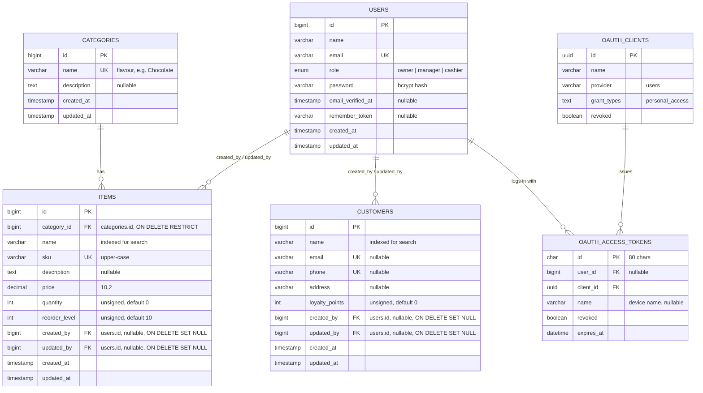

# Database design

The image above is generated from [`er-diagram.dot`](er-diagram.dot) (Graphviz); an [SVG version](er-diagram.svg) is also included. The same model as a Mermaid diagram, which GitHub renders inline:

## Entities

| Table | Purpose |
|---|---|
| `users` | Shop staff who can sign in. `role` is one of `owner`, `manager`, `cashier` and drives every permission check. |
| `categories` | Ice cream flavours (Chocolate, Vanilla, Strawberry, ...). Read-only through the API (`GET /api/categories`), managed by seeders. |
| `items` | Inventory. Every item belongs to exactly one flavour. `quantity` is current stock; an item is *low stock* when `quantity <= reorder_level`. |
| `customers` | Customer records with optional contact details and loyalty points. |
| `oauth_access_tokens`, `oauth_clients` | Created by Laravel Passport. Login issues a personal access token (one row per signed-in device); logout sets `revoked = 1`. |

Laravel's own support tables (`password_reset_tokens`, `sessions`, `cache`, `jobs`, ...) and the remaining Passport tables (`oauth_auth_codes`, `oauth_refresh_tokens`, `oauth_device_codes`) exist but are not used by the API, so they are left out of the diagram.

## Relationships

- **categories 1 — 0..\* items.** `items.category_id` is required. Deleting a flavour that still has items is refused (`RESTRICT`), so stock can never lose its flavour.
- **users 0..1 — 0..\* items / customers** via `created_by` and `updated_by`. These are filled automatically from the signed-in user (`App\Models\Concerns\RecordsAuthors`) and give an audit trail of who added or last changed a record, for example a cashier correcting stock. If a staff account is removed the records stay and the reference becomes `NULL`.
- **users 1 — 0..\* oauth_access_tokens.** A user can be signed in on several devices at once; logging out revokes only that device's token.

## Design decisions

- **Role as an enum column, not a roles table.** The requirements define exactly three fixed roles, so `users.role` is a MySQL `ENUM` backed by the PHP enum `App\Enums\Role`. The role → permission matrix lives in code (`Role::permissions()`), where it is version-controlled and unit-tested cell by cell. Adding a role is a one-line enum change plus a migration.
- **Permissions, not role names, in policies.** `ItemPolicy` and `CustomerPolicy` ask `$user->hasPermission(Permission::DeleteItems)` rather than "is this the owner?", so changing who may do what never touches controller or policy code.
- **Money as `DECIMAL(10,2)`**, never a float, to avoid rounding errors.
- **Unsigned stock columns** so the database itself rejects negative stock.
- **Unique `sku`, customer `email` and `phone`** (nullable unique: several customers may have no email).
- **Indexes on `items.name` and `customers.name`** for the search endpoints.
